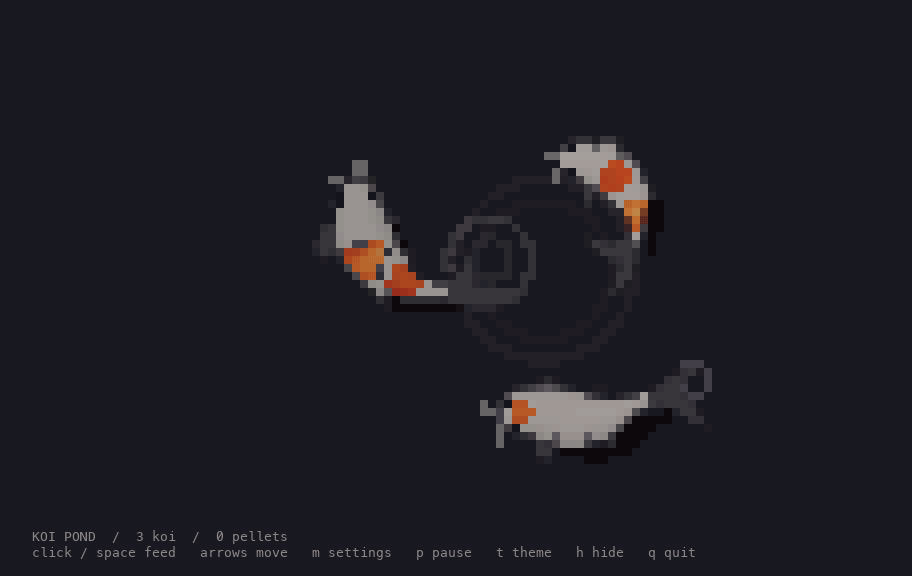
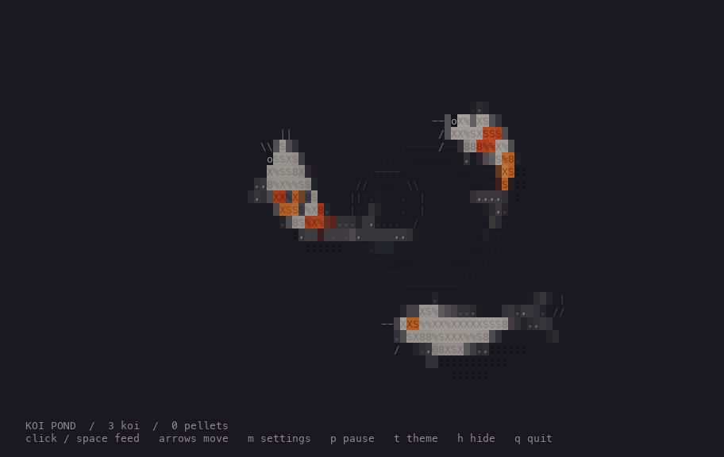

# Terminal Koi Pond

[Dao Ho's koi pond](https://github.com/Dao-Ho/portfolio), swimming in your terminal.
The original fish simulation, flowing tails, wakes, ripples, and feeding
behavior run against an ANSI surface. The default renderer uses `▀`: its
foreground colors the upper half and its background colors the lower half.
That gives two independent pixels per character, doubling vertical detail.
With a typical 1:2 terminal font, those pixels are square.

## Preview

| Half blocks | ASCII |
| :---: | :---: |
|  |  |

## Run

Requires **Node.js 22.18 or newer** and an interactive terminal. No packages to install.

```sh
npm start
```

Or run `node src/cli.ts` directly. For the full colors, use a terminal with
24-bit color support (such as iTerm2, Kitty, or Windows Terminal).
Zooming out your terminal font gives the fish more detail.

The simulation uses physical proportions rather than treating characters as
square. If your font cells have a different shape, set `--cell-aspect` to
**cell height ÷ cell width** (default: `2`). For example, a 9 × 16 pixel font
uses about `1.78`. This corrects fish shapes and circular ripples in either
renderer. Terminals control their own fonts; the app cannot force square cells.

```sh
npm start -- --cell-aspect 1.78
npm start -- --renderer ascii  # original text-tile style
```

| Key | Action |
| --- | --- |
| Click | Drop a handful of food |
| Arrows / WASD | Move the feeding point |
| Space / F / Enter | Drop food at the feeding point |
| P | Pause / resume |
| T | Switch dark / light theme |
| M / , | Open settings |
| R | Start a fresh pond |
| H / ? | Toggle the controls |
| Q / Ctrl-C | Quit |

Press **M** to open the settings panel. **Up/Down** selects an option;
**Left/Right** changes it. **M** or **Esc** closes the panel (Q also closes it).
Changes apply immediately, so you can tune the aspect ratio while watching
the fish. Settings include renderer mode, frame rate, koi count, theme, mouse
input, and the controls strip. Open **Advanced settings** for cell aspect
ratio (steps of 0.05); **Esc** returns to the main menu.
Switching renderer or aspect ratio keeps the current pond and food.
Settings apply for the current run; command-line flags set the startup values.
Half blocks are unavailable when color is disabled.

Fish approach a resting pointer and startle if it moves quickly nearby.
Mouse tracking depends on the terminal; keyboard controls always work.
Hold your terminal's selection modifier (often Shift or Option) to select text
while mouse tracking is enabled, or launch with `--no-mouse`.

```sh
npm start -- --fish 6 --fps 30
npm start -- --light
npm start -- --no-mouse
node src/cli.ts --snapshot --width 100 --height 32
npm test
```

`--no-color` (or `NO_COLOR`) disables color and selects the ASCII renderer.
`--snapshot` also selects ASCII and prints a plain text still frame for pipes.
Half-block pixels require color. Run `npm start -- --help` for all options.
The animation uses the alternate screen, draws only changed cells, handles
window resizing, and restores the cursor and input mode when it exits.

## Credits

Original koi pond by [Dao Ho](https://www.daoho.dev/), from
[Dao-Ho/portfolio](https://github.com/Dao-Ho/portfolio). This project adapts
the pond simulation, fish geometry, and rasterizer for the terminal, with
half-block rendering, keyboard controls, and live settings.

See [ATTRIBUTION.md](ATTRIBUTION.md) for the reference commit and upstream licensing.
